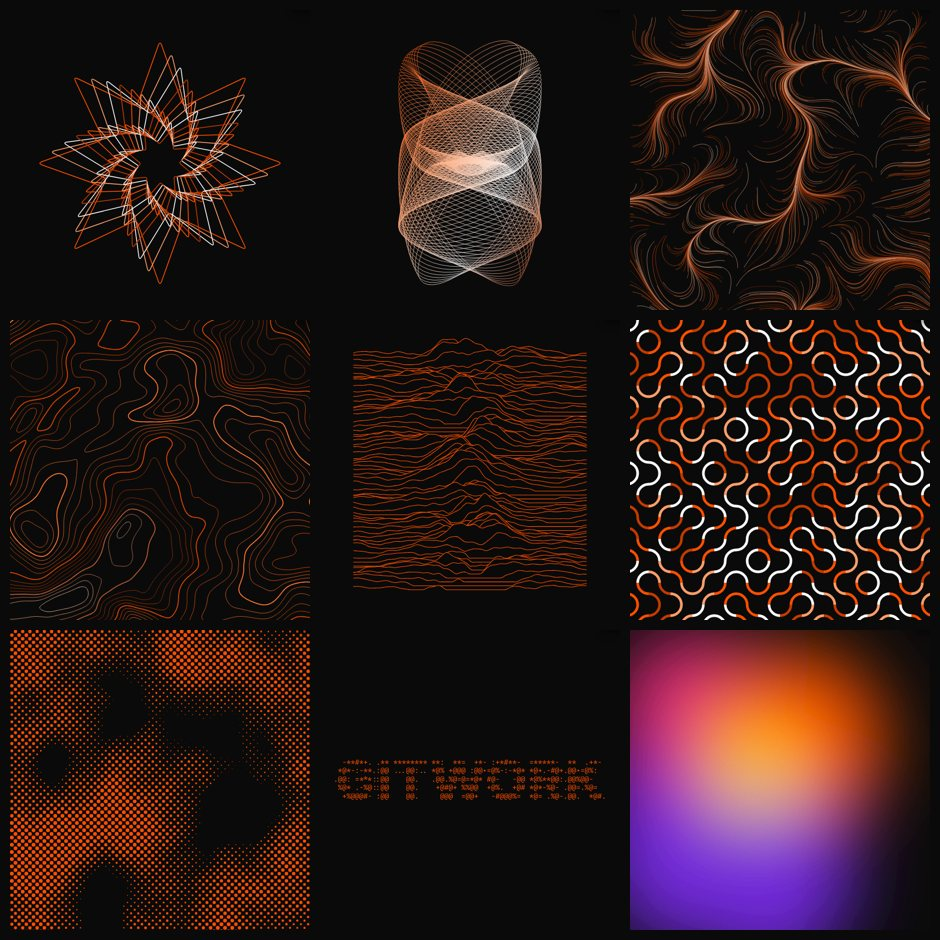

# Canvas by Gitwork

Generative artwork tools in one browser file. Built on the same backend and frame as Foundry Deck: the built HTML file is the app, and once you save it, it is also your artwork. Reopen it and everything is exactly as you left it.



Brand: Emergency Orange (`#FF4F00`) on the Untitled UI v8 design system. See `docs/BRAND.md`.

## Tools

| Tool | Group | What it makes |
|---|---|---|
| Shape maker | Shape | Polygons, stars, flowers, blobs and superformula shapes, repeated into rings or grids |
| Infinite line | Line | One unbroken vector line: harmonographs, spirographs, Lissajous figures and roses, with a draw-on animation |
| Flow field | Line | Hundreds of lines following a noise current |
| Contours | Line | Topographic map lines with index lines |
| Ridge lines | Line | Stacked lines lifted into peaks, each hiding the one behind |
| Tile patterns | Pattern | Truchet arcs, 10 PRINT mazes, triangles, dots, half circles, crosses |
| Halftone | Image | Print-style dots, squares, diamonds or lines from a photo or noise |
| ASCII generator | Type | Words, photos or noise as ASCII art, exportable as text |
| Gradient aura | Colour | Soft blurred colour fields with film grain |

Every tool has: seeded randomise (R), undo and redo, 8 artboard presets plus custom sizes, any background, palettes, and export to SVG, PNG at 1, 2 or 4 times, plain text (ASCII) or the clipboard. Light and dark themes. Works on phones.

## Use it

```bash
npm install
npm run dev        # http://localhost:5173, ?tool=ascii opens a tool
npm run build      # dist/index.html, the whole app in one file
npm run verify     # typecheck, unit, build, Playwright and screenshots
```

Shortcuts: ⌘S save, ⇧⌘S save as, ⌘Z / ⇧⌘Z undo and redo, R new seed, [ and ] switch tool.

Saving uses the File System Access API in Chrome and Edge (pick once, then ⌘S writes in place) and downloads a copy in Firefox and Safari. Unsaved work is kept in the browser and offered back after a refresh.

## Add a tool

```bash
npm run new-tool -- wave-grid "Wave grid" Pattern
```

Then write its `render()`. The controls, saving and export come free. Claude Code does the whole thing from one line if you ask it, using the skills in `.claude/skills/`. See `docs/PROMPTS.md`.

## How it fits together

| Folder | What |
|---|---|
| `kernel/` | The Deck backend, adapted: self-saving file, recovery, version history |
| `src/core/` | Tool contract, seeded random and noise, SVG helpers, palettes, document model |
| `src/tools/` | One file per tool |
| `src/shell/` | The Deck-style frame: topbar, tool rail, stage, numbered settings rail, exports |
| `src/styles/` | Untitled UI tokens and components as plain CSS |
| `.claude/skills/` | How to add tools, keep the brand, reuse algorithms, ship, and start a new studio |

More: `docs/ARCHITECTURE.md`.

## Licences

The kernel is adapted from Foundry Deck, a fork of [Bento](https://github.com/nyblnet/bento), MIT. See `kernel/LICENSE`. Inter and JetBrains Mono are SIL OFL 1.1, embedded in the build.
